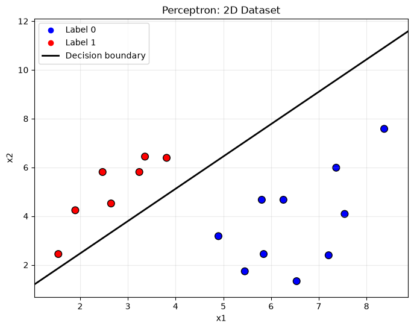
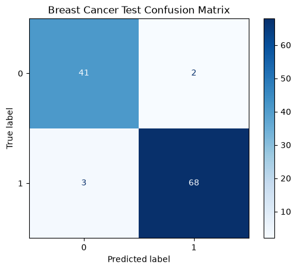

# Perceptron

A small NumPy implementation of the perceptron, a linear classifier for
binary classification. The implementation is in [`perceptron.py`](perceptron.py);
the accompanying notebook explains the algorithm and demonstrates it on
several datasets.

## How it works

For a feature vector \(x\), the perceptron calculates a linear score:

\[
s(x) = W \cdot x + b
\]

It predicts class `1` when the score is positive and class `0` otherwise.
During training, labels are represented internally as \(-1\) and \(+1\). If a
training sample is misclassified or lands on the decision boundary, its
weights and bias are updated:

\[
W \leftarrow W + \alpha y_i x_i,\qquad
b \leftarrow b + \alpha y_i
\]

Here, \(y_i\) is the signed label and the learning rate \(\alpha\) is `0.1`.
Training repeats over the samples for the configured number of epochs
(default: `1000`).

## Visual walkthrough

The notebook plots the two-dimensional sample data and the learned linear
decision boundary:



It also evaluates the classifier on the breast cancer dataset and visualizes
the test predictions as a confusion matrix:



These figures are saved from the outputs of
[`notebooks/perceptron_explanation.ipynb`](notebooks/perceptron_explanation.ipynb).

## Project contents

- `perceptron.py` — classifier implementation and `fit`/`predict` methods.
- `data/data.csv` — two-feature classification dataset (`x1`, `x2`) and its
  binary `label`.
- `tests/test_perceptron.py` — checks NAND behavior, the CSV dataset, and
  classification on breast cancer data.
- `notebooks/perceptron_explanation.ipynb` — explanation, runnable examples,
  and visualizations.
- `images/` — plot images shown above.

## Try it

From the project root, import and use the classifier:

```python
import numpy as np
from perceptron.perceptron import Perceptron

X = np.array([[0, 0], [0, 1], [1, 0], [1, 1]])
y = np.array([1, 1, 1, 0])  # NAND

model = Perceptron()
model.fit(X, y)
print(model.predict(np.array([[1, 0], [1, 1]])))  # [1 0]
```

Run the tests from the project root with:

```bash
python -m pytest perceptron/tests
```

To follow the full walkthrough, open
`perceptron/notebooks/perceptron_explanation.ipynb` in Jupyter. The notebook
uses NumPy, pandas, Matplotlib, and scikit-learn.

## Scope and limitations

The perceptron learns a linear decision boundary, so it can classify
linearly separable data but cannot represent nonlinear boundaries such as
XOR. For datasets with features on very different scales, standardize the
features using statistics computed from the training set before fitting.
